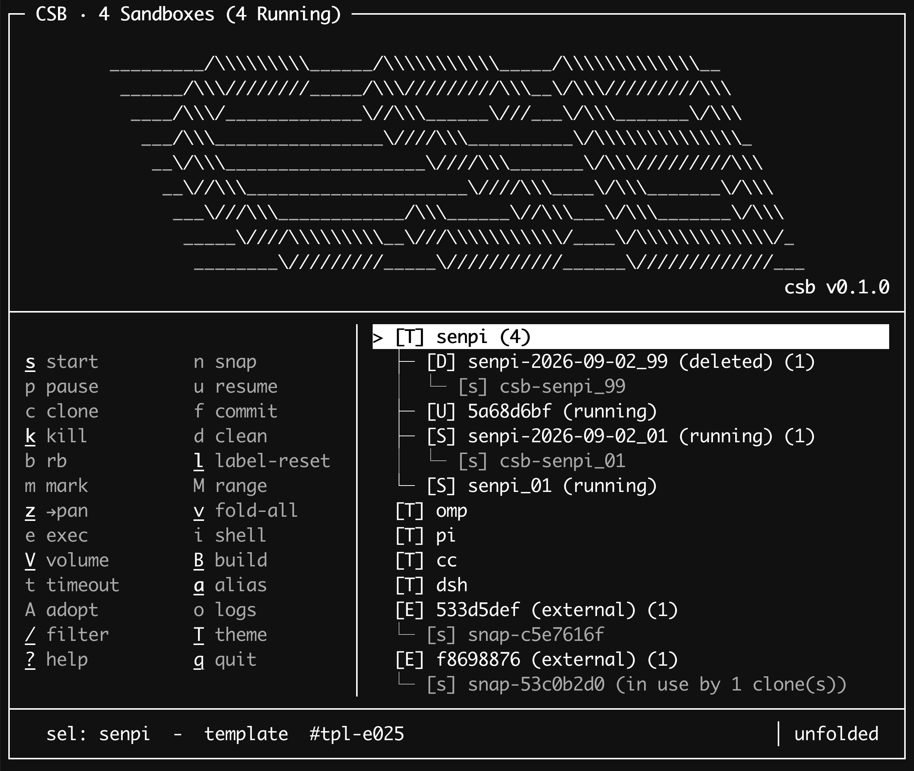

# CSB-TUI — a tree-shaped console for CubeSandbox

English · [简体中文](README.zh.md)

> CubeSandbox's CLI and WebUI locate resources mostly by id, so you have to piece the relationships together on your own; **CSB-TUI fills that in as a tree** — names, families, sequence numbers and lineage live on your machine.

> [!WARNING]
> **This is an experimental build and may still have bugs.**

<p align="center">
  
</p>

<p align="center">
  <sub>Five built-in skins — obsidian (default), synthwave, amber, matrix, paper. Press <code>T</code> to cycle; your choice is remembered.</sub>
</p>

<p align="center">
  
  
  
  
  
</p>

CSB is a tree-shaped console in your terminal. Resources live in the cluster; names and lineage live on your machine.
`csb xxx` is a **command**; a `single letter` (such as `s` or `n`) is a **key** — both do the same thing.

## Contents

**Quick start** [What it is](#what-it-is-and-what-it-does) · [Install and launch](#install-and-launch) · [First steps](#first-steps)

**Understanding CSB**　[Reading the tree](#reading-the-tree-nodes-and-markers) · [Naming and lineage](#naming-and-lineage) · [Sandbox lifecycle](#sandbox-lifecycle) · [Three kinds of snapshots](#three-kinds-of-snapshots-are-not-the-same-thing) · [Local ledger and sharing](#local-ledger-and-sharing)

**Look things up** [Keys and actions](#keys-and-actions-at-a-glance) · [Egress (proxy)](#egress-proxy) · [Command-line reference](#command-line-reference) · [Exit codes and flags](#exit-codes-global-flags-and-signals) · [Environment variables](#appendix-environment-variables) · [Where settings live](#where-settings-live) · [Node types](#appendix-node-types-at-a-glance)

**When something breaks**　[Troubleshooting](#troubleshooting) · [License and credits](#license-credits-and-contributing)

## What it is and what it does

```text
   your terminal
      │  csb                    ← the only entry point
      ▼
   tree console csb_tui.py     ← rendering and keys; every key calls the same commands below
      │  import csb
      ▼
   command layer csb.py        ← ledger, lineage, safe deletion
      │  official Python SDK + raw REST
      ▼
   CubeSandbox cluster         ← templates / sandboxes / snapshots / volumes
```

- **A tree drawn from lineage**: templates, sandboxes, snapshots, signposts and unregistered resources share one tree; the key bar on the left changes with the cursor.
- **One set of commands powers both the UI and the CLI**: the same commands ⇒ `-o json` on the command line only; fixed exit codes on both sides.
- **Batch operations**: `m` marks one item, `M` a whole section; marks are type-locked (sandboxes and snapshots cannot mix); one confirmation, one summary, and failures record the reason per item without rolling back the batch.
- **Official interfaces only**: the official Python SDK (with `csb admin` only passing through the official `cubemastercli`); `i` opens tmux / screen / Herdr.

## Install and launch

### Requirements

| Needed | Why |
| --- | --- |
| Python ≥ 3.10 (3.14.4 tested here) | Pure Python, no build step |
| cubesandbox ≥ 0.7.3 | Official SDK, the only runtime dependency |
| A real terminal (TTY) | In a non-terminal, csb prints `csb: give me a command - "csb help" lists them` and exits with **2**; `csb ls` does not need a TTY |
| Cluster address and key | Defaults point at localhost |

Official SDK **0.7.3**, local cluster **platform** **v0.7.3**. Defaults are `http://127.0.0.1:3000` plus a placeholder key for development; add `SSL_CERT_FILE` for self-signed certificates; to reach another cluster, change `CUBE_API_URL` / `CUBE_API_KEY` together.

Without wildcard DNS you **must** set `CUBE_PROXY_NODE_IP` (symptoms and fix are in the network section of [Troubleshooting](#troubleshooting)).

### Install

From PyPI: `pipx` is recommended (installs into an isolated environment, leaving system Python alone):

```bash
pipx install csbtui        # recommended: isolated env, does not touch system Python
```

If you prefer `pip`, or already have an environment (venv / system Python):

```bash
pip install csbtui         # second choice: installs into the current env; a venv is recommended
```

No `sudo`, and installation does not contact the cluster. You do not need to prepare a config file: the first command you run creates `~/.config/csb/` (with no `config.json`, built-in defaults are used). Once installed, type `csb` to enter the tree (only a real terminal gets in).

### After installing, check three things

```bash
csb --version  # is it installed (should print csb 0.1.1)
csb tz         # clock skew between your machine and the server (time columns drift when the two zones disagree)
csb ls         # can you reach the cluster (reads sandboxes only; creates no ledger entries; writes one audit line and reclaims dead sbx policies along the way)
```

`csb ls` only reads the sandbox list, but every command writes one audit line; after a successful `ls` or `start`, CSB also reclaims "dead sbx policies" — it needs two separate sightings of the same one, at least 600 seconds apart, before acting; `CSB_AUTO_SBX_SWEEP=0` turns this off (see [Appendix: environment variables](#appendix-environment-variables)).

### After installing, which files are there

```text
csbtui/
├── csb.py                   command layer: 36 commands
├── csb_tui.py               tree console (the TUI, the only frontend)
├── pyproject.toml           packaging metadata
├── README.md                this file
├── README.zh.md             Chinese version of this file
├── csb-demo.gif             the demo image used in this README
└── LICENSE                  MIT
```

### Uninstall

```bash
pipx uninstall csbtui      # removes the program only; ~/.config/csb/ stays
```

For a `pip` (non-pipx) install use `pip uninstall csbtui`.

Things to know:

- Uninstalling removes the program only; `~/.config/csb/` and resources on the cluster are untouched.
- To wipe the local ledger, `rm -rf ~/.config/csb`; when `CSB_REGISTRY` points at a shared path, deleting it deletes other people's names too.
- Do not mix `pipx` and `pip` installs; uninstall with the same tool you installed with. `cubesandbox` is a separate package and is not removed with it.

## First steps

Type `csb` in a terminal to enter the tree.

```text
[T] senpi (3)                                 ← template, 3 direct children below
  ├─ [S] senpi_02 (paused) (1)                ← within a level, newer sits on top (top to bottom = newest first)
  │  └─ [S] senpi_03 (running)                ← cloned from senpi_02
  ├─ [S] senpi_01 (running) (1)               ← sandbox, 1 snapshot hanging below
  │  └─ [s] csb-senpi_01
  └─ [D] senpi_00 (deleted) (1)               ← sandbox is gone, snapshot remains as a signpost in place
     └─ [s] csb-senpi_00
```

**Step 0: you need a `[T]` on the tree before you can start a sandbox** — `csb start` accepts four sources (alias / template id / snapshot id / snapshot name). Without a `[T]`, press `B` to build one from a container image; if an anonymous template already exists, press `A` to name it (see [Templates without an alias](#templates-without-an-alias) for where those come from).

**Start a sandbox** — with the cursor on a template node, press `s`. It asks in order (`Esc` steps back one question, and on the first question cancels; choosing `off` for `network` skips the allow-list and proxy pages):

1. **Name** — Enter takes the default `<family>_<seq>`; a name you type stays **forever**.
2. **Count** — Enter means 1 sandbox; more than 20 asks once more.
3. **network** — `on` / `off`.
4. **allow out** (only when `on`) — pick a recently used set, `all`, or type one; `d` deletes the current set. Separate multiple sets with `,` `;` `、` `|` or spaces; empty entries and non-CIDR values are rejected on the spot. Choices are remembered: next time the cursor starts on `(review last egress profile)` (applies the whole set list and proxy, skipping the proxy page), on `(use template network policy)` when the template has a policy, otherwise on the current list.
5. **proxy** (only when `on`) — pick a URL or `none`; `d` deletes the current one. Choices are remembered.
6. **Volume** — pick a volume → path (Enter gives `/data`) → read-only or not; **it mounts as soon as you choose, with no second confirmation**; to mount nothing pick `(do not mount a volume)`, where `(same as last time: …)` sits at the top, and Enter reuses it.

**Work inside** — on a sandbox node press `e` to run one command, or `i` for a real terminal (copies the command, opens a tmux window; inside Herdr it can open another Herdr pane); Enter shows full details, `o` shows runtime logs, `?` lists every key.

**Leave a restore point** — press `n` to take a snapshot; the default name is `csb-<source-sandbox>_<date>`. A snapshot is **independent of the sandbox** (it survives sandbox deletion). A failed take shows `(FAILED)`; it cannot be rolled back but **can still be deleted** (select it and press `d`).

**Copy a sandbox** — press `c` to clone N sandboxes. The clone first takes one temporary snapshot to share, which appears on the tree as the `[s] snap-xxxx` under the parent sandbox marked `(in use by N sandbox)`; **CSB does not reclaim it for you** — once all copies are gone, select it and press `d` (clean), or run `csb snaprm <id> --yes`.

**Clean up** — press `k` to delete sandboxes (one confirmation). **Deleting a sandbox does not delete its snapshots** (platform design): the node turns into a `[D]` signpost in place with snapshots hanging under it. To clean it fully, empty the snapshots and sandboxes below first, then go back to the signpost and press `d`.

**Filter** — `/` filters nodes by substring, `Esc` clears it (pressing `/` and entering an empty string works too); the tree refreshes every 2 seconds, and `r` refreshes immediately. You can filter by name / id / state / type / family / template / volume name (a volume name lists every sandbox that mounts it, including the parent node). **When a filter and marks coexist, `Esc` clears the filter first and keeps the marks; a second press clears the marks** (the status line reports how many marks remain).

- **Marks and batches** — `m` marks the current node (and makes it the anchor); after moving the cursor, `M` marks or unmarks a whole section. **Type lock**: a batch cannot mix sandboxes and snapshots; one confirmation, one summary, and failures record the reason per item without rolling back the batch.
- The 9 keys that act on a whole batch: `k` kill, `n` snapshot, `p` pause, `u` resume, `t` timeout, `c` clone, `d` delete snapshot / clean leftover, `A` adopt, `e` exec.
- Batches only accept those 9 keys (`s` / `i` / `o` / `f` / `b` / `l` / `a` do not); `commit` runs one sandbox per call; rollback (`rb`) takes a single sandbox and cannot be batched; the command line has 7 batch commands: `kill` / `pause` / `resume` / `timeout` / `clone` / `snaprm` / `exec`.

> **`A` batches only reach unnamed sandboxes**: unnamed templates cannot be marked; naming is always one at a time.

`Ctrl-C` and `kill -INT` are not forwarded into the sandbox (`--sig` also accepts `KILL` / `HUP` / `INT` / `QUIT`); platform-provided services (envd / jupyter) are skipped by default — add `--force` to operate on them; a sandbox whose services were touched can only be deleted and rebuilt.

## Reading the tree: nodes and markers

| Marker | What it is | Where it comes from |
| --- | --- | --- |
| `[T]` | Template | An official template; the alias can be changed |
| `[S]` | Sandbox | A sandbox you created, with name and state |
| `[s]` | Snapshot | A restore point of a sandbox, independent of it |
| `[U]` | Unnamed on both sides | Neither side knows a name for it (named ones are in [Appendix: node types at a glance](#appendix-node-types-at-a-glance)) |
| `[D]` | Signpost | The **sandbox** is gone but its snapshots remain; **or** the template no longer exists on the server (only the local ledger row is left) |
| `[E]` | External signpost | The snapshot records a source id, yet that sandbox cannot be found on either side |
| `[X]` | Leftover | The local ledger has it but the server no longer does |

- `(running)` / `(paused)` / `(deleting)` are platform states; `(deleted)` / `(external)` / `(stale)` / `(orphan)` are the labels CSB attaches to signposts and leftovers; `(N)` is the number of **direct** children below (a signpost counts); the indented `*` / `>` / `#id` mean mark / cursor / duplicate-name disambiguation.
- The list above covers the **commonly used ones only**; **all 20 types are in [Appendix: node types at a glance](#appendix-node-types-at-a-glance)**.
- **The marker shows the type, the name column shows the server**: sandboxes always read `[S] <name>` or `[S] <id8>`; press `A` to adopt a node into the local ledger (`[U]` is reserved for the one that has no name on either side).
- **A clone's temporary snapshot is tagged `(in use by N sandbox)`**: N is the number of sandboxes using it **right now**; CSB **does not reclaim it automatically** — clean it yourself with `csb snaprm <id> --yes`.
- **`[s] unattached snapshots`**: snapshots whose source is unknown on both sides and that have no local ledger row gather in this row (`snap-xxxxxxxx (orphan)`); you can still start them with `csb start` and delete them with `csb snaprm`.

### Six nodes that "look wrong"

- `[D]` is the sandbox signpost: the server keeps only the snapshot's source id (`originSandboxID`); the name and timestamps are filled in from the local ledger.
  `Enter` shows the same set of fields; to clean it up: clear the snapshots → delete the cloned child sandboxes → press `d`.
- `[D]` is also a template leftover row (gone from the server, present only locally); `s`/`l` display it but cannot act on it; press `k` to clear it (`csb tpl rm <alias|id> --yes`); the full alias/id is printed before confirmation.
- `[E]`: the source id of a snapshot is unknown on both sides (the ledger has no such row); while the snapshot exists, `csb tree`/the TUI re-adds a landmark
  (`seen:true`), and it disappears once the last snapshot is deleted; `CSB_AUTO_NO_SEEN=1` turns this off.
- `[X]`: present locally, absent on the server; press `d` to clear it (`CSB_AUTO_HIDE=1` clears quietly, `CSB_AUTO_HIDE_ASK=1` asks first — only when the list is complete).
- `[U]`: no name on either side; press `A` to adopt it (an unnamed template goes through the official `set-alias`).
- Unregistered locally but named on the server: the marker follows its type (for example `[S] pi`), and the name column uses the server name.

### Ordering and time

Within one level, nodes are ordered by **time**, **newest on top**; timestamps are recorded in **UTC** and displayed in local time with an offset
(`2026-09-14 22:46:47 +08:00`); `metadata.*` is passed through unchanged (`-o json` keeps the original values); check clock skew with `csb tz`.

Rows with no known time sort to the top (usually the step you just took); the platform gives no time for a clone's temporary snapshot, so CSB fills in the clone's time.

Root group order: `[T]` (new → old) → `[D]` / `[E]` with a local timestamp (new → old) →
the three timestamp-less groups in alphabetical order: `[X] leftover record` → `[U] no local name yet` →
`[s] unattached snapshots`; inside a group by time, and `[U]` by type first, then time.
The rest (missing source → `[E]`, platform gives no source → unattached) is explained in [Appendix: node types at a glance](#appendix-node-types-at-a-glance).

## Naming and lineage

### Three layers

| Layer | What it is | Looks like | Used for |
| --- | --- | --- | --- |
| 1 | **label** | `<family>_<seq>`, e.g. `senpi_03` | the human-facing name |
| 2 | **ts** | server `startedAt` (second precision); a snapshot-sourced sandbox carries the source time | ordering, restoration |
| 3 | **id** | 32 hex digits | the single anchor for tracing back |

| Term | In one line |
| --- | --- |
| Family | the root template alias; clones inherit it |
| Sequence | the high-water mark is never reclaimed; only `label-reset` can push it back; if the ledger was deleted, CSB backfills it from the server metadata `csb.nseq` |
| Rename counter | `tpl alias A B` carries the counter; the old key is kept only while resources still point at it, otherwise reclaimed |
| Snapshot naming | a `--label` prefix becomes a new family; without it the source family is kept |
| Name priority | metadata → template alias → `<family>_NN` |

- **Cleaning dead high-water marks**: `csb tpl clean-hw` (dry-run by default) lists count records that nothing points at; `--yes` backs up `highwater.json` and then deletes them; old names in `alias_history` are always kept.
- **A metadata name does not take a new sequence number** (`nseq` stays empty); when the name looks like `<family>_NN`, that number **counts toward the family high-water mark** (claims the number), so later automatic numbering cannot collide with it; a name without a sequence number claims nothing. Within one ledger, sequence numbers only go up (no reuse); only `csb label-reset` can push them back (destructive); `tpl alias` reclaiming an old key, `tpl clean-hw` deleting a count, and deleting the whole ledger all make old numbers assignable again.
- **Reset** (`l` / `label-reset`, one confirmation): the family has no sandboxes on the server and no snapshots locally; live resources make it refuse.
  In the TUI, `l` on a template node acts on the **family alias** (not the template id).
- Default names: snapshots `csb-<source name>_<date>`; templates `<family>-commit-<date>`.

### Who can rename what (rename matrix)

| Object | Named when | Rule | Renamable? | How |
| --- | --- | --- | --- | --- |
| Template alias | At creation or later | `^[a-z0-9][a-z0-9-]{0,63}$`, cannot start with `tpl-` / `snap-` | Yes | Press `a` on the node or run `csb tpl alias`; collisions are refused (rc=2), see the NOTE below |
| Template id | At creation | `tpl-` + 24 hex digits | No | — |
| Sandbox id | At creation | 32 hex digits | No | — |
| Sandbox name | At creation (written into metadata) | csb accepts `[\w-]{1,64}` (Unicode included; emoji / spaces / `.` are blocked by csb); **unique within the same family in the local ledger** — another ledger or the WebUI may still use the same name (distinguish with `#id`) | **No** (the official API has no update endpoint) | Delete and recreate, or recreate from a snapshot |
| Snapshot name | When taking the snapshot | Free text (recommended not to start with `tpl-` / `snap-`) | No | — |
| Volume name | At creation | Alphanumerics, `_`, `-`, up to 128 (the name is the id) | No | — |
| Family sequence | Maintained by CSB | High-water mark | Yes (local only) | `l` or `csb label-reset` |

> [!NOTE]
> **Changing an alias moves things on the tree**: pointing a template at an existing family name instantly re-parents that family (including `[D]` signposts and sandboxes made on other machines); `[E]` does not move. CSB intercepts collisions first (rc=2, before touching the server); there is no such guard server-side, so another tool renaming directly drops the original template back to an unnamed `[T] tpl-xxxxxxxx`.

### Templates without an alias

- `template commit` without an alias ⇒ an anonymous template, shown as `[T] tpl-<id8>`; the ALIAS column of `csb tpl ls` prints `-`, with the full id in the ID column.
- To name it press `A` (or run `csb tpl alias <id> <name>`): the name is stored on the server; collisions are refused — use the official `--clear` first if you must take one over.
- A sandbox named on the server but not registered locally shows the server name; only a template that cannot be found at all lands in `[U] no local name yet`.
- CSB's `f` defaults to `<family>-commit-<date>`, and a second commit on the same day becomes `-2` / `-3`.

## Sandbox lifecycle

```text
create ──► running ──pause──► paused ──resume──► running
              │                 │
            kill              kill
              ▼                 ▼
          terminated        terminated
```

**A paused sandbox accepts only these commands**: `ls` / `info` / `snaps` / `logs` / `tree` are read-only, `resume` and `kill` work (a second `pause` is a no-op that returns 0); everything else returns `rc=3` (the message carries the reason and the fix). **The one exception is `csb net`**: changing the network while paused returns `rc=2`.

**Success messages**: `start` / `clone` / `commit` / `snap` / `kill` / `rb` print two lines
(name + action / `id  <full id>`); `resume` / `timeout` / `pause` print one line (`resume --timeout` adds an `idle TTL` line).
```text
pi_52  started
id  3ac4e4d59f5b4531b2b6c00da074cc9b
```

CSB creates sandboxes with `on_timeout=pause`, a 30-day `timeout`, and **no** `auto_resume` (the platform default is `false`): they pause automatically when idle; because CSB does not pass `auto_resume`, a paused sandbox is not woken automatically and needs `csb resume` — if another client explicitly sets `auto_resume=true`, behavior differs. Press `t` to change the idle duration (seconds; `0` = immediately, `-1` = never; greyed out while paused).

- **Fidelity**: CPU / memory / internal TCP state are kept across a pause, while external connections drop and applications reconnect after resume (see [Sandbox Lifecycle](https://cubesandbox.com/guide/lifecycle)).
- `timeout` counts idle time: it resets only when the SDK performs an operation or an HTTP call reaches the sandbox directly; `ls`/`info`/looking at the panel do not count.
- The platform default is `on_timeout=kill`; CSB uses `pause` by default to keep idle sandboxes from being reaped.
- The effective deadline is `end_at` from `csb info` (never timing out = the platform omits the value and CSB prints `none`); every request refreshes it.
- Nothing counts down while paused; the last setting is authoritative.
- `pause` is asynchronous on the platform, so the old deadline still shows until it takes effect; `resume` returns 409 when the node has no capacity (Cubelet `130409`), and can be retried.

## Three kinds of snapshots are not the same thing

| Kind | Produced by | Relation to the sandbox | In CSB |
| --- | --- | --- | --- |
| **User snapshot** `snap-*` | You press `n`; a clone's temporary snapshot also counts | Independent; survives sandbox deletion | `[s]` |
| **Pause snapshot** | Created internally by the platform on `pause` | Lives and dies with the sandbox | Does not appear |
| **Template snapshot** | An internal copy when the platform builds / distributes a template | Belongs to the template | Does not appear |

CSB's cloning does three things the official flow does not: copies carry `timeout` / `metadata` / `on_timeout`; the temporary snapshot is recorded in the ledger (findable and deletable); and CSB does not reclaim it automatically.

> Deleting a snapshot **by name** in a script: when the name is unique the command deletes it; when the name matches several snapshots CSB **refuses with rc=2**, printing only the first full id plus
> `(+N more, see csb snaps)`; use full ids instead (several ids at once are fine, CLI batch).
> When the platform still has a live reference (a sandbox runtime restored from this snapshot) it only **asks one more time**, and an answer of `y` deletes;
> when it is still on the CSB tree (a sandbox uses it as a template) **it is refused without `--force`**.

## Local ledger and sharing

On the official side a sandbox has only an id; names, families, lineage and audit are added by CSB and recorded under `~/.config/csb/`.

> **Do not delete these files**: the name ↔ id mapping lives mainly in the ledger, and deleting it turns old ids into orphans (`[E]` / `[U]`, snapshots without a parent). If you really must touch them, copy first (`cp <file> <file>.bak-<date>`).

```text
~/.config/csb/
├── config/                    ← preferences and switches
│   ├── config.json            ← theme, timezone offset, seen list, allowed CIDRs
│   └── switches.json          ← switches written by `csb config set`
├── ledger/                    ← ledger (managed by the program; hand edits break it)
│   ├── sandbox-registry.json  ← names / families / lineage / snapshot sources
│   ├── highwater.json         ← family sequence high-water marks (deletion does not reclaim)
│   └── .csb-snapshots.json    ← local snapshot ledger
└── log/                       ← logs
    ├── audit.log              ← one line per command; rotates past 100 MiB
    └── tui-error.log          ← clues for TUI crashes
```

- **Audit and ledger**: once the audit exceeds `CSB_AUDIT_MAX` (100 MiB by default) it is renamed and archived; a corrupt ledger is backed up before continuing, dropping only the bad lines.
- **The ledger's `version` / `schema` is a schema number, not the csb version**: it is always `1`; do not change it to `0.1.x` — older builds treat the whole ledger as a foreign format and rebuild it empty (backed up first, but every name is lost). Newer builds keep the data, warn, and normalise it to `1` on the next write; old files with no such field are kept as schema 1 too.
- **Opening the TUI auto-adopts**: it runs on every start, adopting only sandboxes the ledger does not have yet (existing records are not rewritten), and it writes locally only; `CSB_AUTO_NO_ADOPT=1` turns it off. Naming order and collision rules are in "Name priority" under [Naming and lineage](#naming-and-lineage).
- **Undo**: when the hint appears in the bottom-right, press `U` to undo only the adoptions not yet finalized in this run; a normal exit finalizes them; to change later use `csb adopt --undo` (includes finalized ones) or `csb clean --ledger`; editing the JSON by hand is the last resort. Read-only commands create no ledger rows, but every command writes one audit line (`CSB_AUDIT=` turns it off). **The next launch adopts again**.
- **Moving machines / backups / several machines on one cluster = copy the whole `~/.config/csb/`** (all three data files):
  ```bash
  cp -a ~/.config/csb/ /your-backup-dir/csb-$(date +%Y%m%d)/
  ```
  **Sharing between people**: point `CSB_REGISTRY` at one path (such as `/srv/shared/sandbox-registry.json`, group-writable) and the other two files follow automatically; writes take a file lock and re-read and merge first.
- **CSB never deletes your things on its own**: server resources change only when you say so (`kill` / `snaprm` / `tpl rm` / `d` to clear a signpost); local zombie rows stay until you press `d` (`CSB_AUTO_HIDE=1` clears quietly, `CSB_AUTO_HIDE_ASK=1` asks first), and are kept as a `[D]` signpost while snapshots still point at them. When the list is incomplete, auto-hide skips entirely and prints `warning: incomplete list (<reason>) - auto-hide skipped`, so a live sandbox is never mistaken for stale. Idle sandboxes being reaped by the platform is a platform rule.
- **Permissions**: inside a sandbox you are `root` (no sudo); the local ledger belongs to the user running csb; the cluster side follows the API key — this guarantees "won't delete other people's things by mistake", not "can't delete other people's things".

## Keys and actions at a glance

**Splash animation**: the logo plays at startup (about 2 seconds); skip it with `CSB_UI_NO_SPLASH=1 csb`, and turn off just the permanent sweep with `CSB_UI_NO_SWEEP=1` (see [Appendix: environment variables](#appendix-environment-variables)).

The key bar is fixed at **26 keys (13 rows × 2)**; below is the complete reference (including items not drawn on the bar: show info, `Esc`, refresh, arrows and paging). Underlined = available; not underlined = greyed out.

| Section | Key | Description |
| --- | --- | --- |
| Navigate | `↑` `↓` move | Move the selection |
|  | `PgUp` `PgDn` page | Up / down 5 nodes (may cross into a parent) |
|  | `Home` `End` first/last | First / last of the same level and type (does not cross parents) |
|  | `F5` `r` refresh | Refetch (normally auto-refreshes every 2 seconds; CSB_TUI_POLL) |
| Inspect | `Enter` `Space` info | Full-info popup (scrollable; sections for identity / endpoints / runtime / resources) |
|  | `?` help | Help popup (scrollable; a completed panel also closes with `Enter`) |
|  | `←` `→` fold node | Collapse the current node; without children, collapse its parent (in pan mode: scroll left/right) |
|  | `z` fold | Toggle between fold / pan mode (hints `→fold` / `→pan`) |
|  | `v` fold all | Collapse / expand everything under the current template |
|  | `/` filter | Filter (substring over name / id / state / type / family / template / volume name; empty clears) |
| Create | `s` start | Start a sandbox (template node / snapshot node) |
|  | `f` commit | Freeze a sandbox into a template |
|  | `c` clone | Clone |
|  | `B` build | Build a template from a container image (asks for image address and alias) |
|  | `V` volume | Volume panel (select / info / delete / create) |
|  | `T` theme | Cycle skins (five) |
|  | `a` alias | Change the alias (template node) |
|  | `A` adopt | Adopt an unnamed sandbox or an anonymous template (an anonymous template is named on the server); snapshots are not adopted; batch: several unnamed sandboxes |
| Execute | `e` exec | Run one command (same as `csb exec`); with ≥2 marked = run the same command on those N |
|  | `i` shell | Interactive shell menu (up to four entries) |
| Snapshot | `n` snap | Take a snapshot |
|  | `b` rb | Rollback, only on a snapshot node |
|  | `o` logs | View logs (filters out clock-check noise) |
|  | `d` clean | Delete a snapshot / clear a signpost (depends on node type); **batch: delete several snapshots** |
| State | `p` pause | Pause |
|  | `u` resume | Resume |
|  | `t` timeout | Idle timeout (0 = immediate, -1 = never) |
|  | `k` kill | Delete sandboxes / delete a template (depends on node type); **batch: delete several sandboxes** |
|  | `l` label-reset | label-reset (template node) |
| Batch | `m` mark | Mark the current node (sets the anchor); `Esc` clears all (with ≥2 marks, non-batch keys are refused: `<action>: no bulk (Esc clears the marks)`); **with a filter open, `Esc` clears the filter first and the marks wait for the next press**; **during a batch run, `Esc` stops the whole batch (the rest do not run), with a single summary** |
|  | `M` range | Mark a range (press again to invert) |
| Popup | `↑` `↓` scroll / `PgUp` `PgDn` page | Scroll / page (the bottom-left shows current / total pages past one page) |
|  | `Esc` close | Close the popup (any time; a completed panel also closes with `Enter`) |
|  | mouse | Click a node / click the key bar / scroll wheel |
| Panel | `q` quit | Leave |

**Two things that do not fit in the table:**

- The `i` **shell** menu has **at most four entries, varying with the environment**:
  ① **Copy** `csb shell <id>` to the clipboard (shows the command only when no clipboard tool exists);
  ② **tmux / screen**: opens another window named after the sandbox (with `CUBE_API_URL` / `CUBE_API_KEY` / `CSB_REGISTRY`); this entry appears only when the TUI itself runs inside tmux/screen (`$TMUX`/`$STY`) — a plain terminal has no such row and the footer suggests entering a multiplexer first;
  ③ **Herdr pane**: appears only when `HERDR_ENV=1` + `herdr` is on `PATH` + `herdr status` returns 0;
  ④ **Show the command only** and copy it yourself. `exit` inside the sandbox comes back.
- **Mouse**: clicking a node moves the cursor; clicking the key bar presses that key (destructive keys still confirm); the wheel scrolls / moves the cursor 3 nodes.
  **Clicks do not work inside panels or input boxes**, though the wheel still scrolls; the main path is ↑↓ + `Enter` + `Esc`.

> [!NOTE]
> `B` build, `V` volume, `T` theme, `?` help, `q` quit, `z` fold, `v` fold all and `/` filter work on any node.
> Inside input boxes and popups `Esc` only cancels / closes; to leave, press `q` on the tree.
> **When the window is too narrow** (say 80x24) for the left key list, the last row shows only `? help` — press `?` for the full table; keys are never hidden silently.

### Laptop key mappings

| Fn combination | Equivalent key |
| --- | --- |
| `Fn` + `←` | `Home` |
| `Fn` + `→` | `End` |
| `Fn` + `↑` | `Page Up` |
| `Fn` + `↓` | `Page Down` |

## Egress (proxy)

The decision is made once when the sandbox is created; afterwards `csb net` can change it (replacing the whole set).

| `--net` | What else to pass | Effect |
| --- | --- | --- |
| `off` | Nothing else | Fully cut off |
| `on` | `--allow-out` or `--proxy`, at least one | Everything open by default; a list = allow only those (block the rest); a proxy = egress goes through it |
| not passed | — | Inherit the template policy (= platform default when the template has none); write `off` explicitly to cut the network |

- `--net on` is not "everything open" but "this time you pick the policy": writing `--net on` without `--allow-out` or `--proxy` is an error (rc=2), and no sandbox is created.

- `--allow-out`: passing a list means **allow only those CIDRs or domains** (`example.com` / `*.example.com`; domains need DNS, and csb also sends `deny_out 0.0.0.0/0`).
  The allow-list passes DNS automatically: after creating the sandbox, csb reads its `/etc/resolv.conf` and adds the resolvers to the list (falling back to `--dns-server <ip>` when unreadable); use `--no-dns` to allow IPs strictly only. `all` = allow everything, but the three senders differ: `csb net` sends an empty list, `csb tpl build` writes no policy, and `csb start` sends `allow_out ["0.0.0.0/0"]` + `deny_out []`.
- Templates can bake the network in: `tpl build --allow-out <cidr> --deny-out <cidr> --no-internet` (no domains; `--allow-out all` = write no policy, inheriting resolves to fully open per platform default; templates have no DNS option). `start` **with no network flags at all = inherit the template**; for fully open pass `--allow-out all`. The CLI has no remembered mode (it is manual); remembering exists only on the TUI's two-column allow-out page: `(review last egress profile)` / `(use template network policy)`.
- With `--proxy` alone and no list, CSB automatically puts the proxy host (`/32`), `0.0.0.0/0` and DNS into the allow-list.

### Changing the network after creation: `csb net`

`csb net <id> --allow-out <cidr|domain>[,...]` = allow-list; `--allow-out all` = fully open; `--net off` = fully cut off. The platform **replaces the whole set**, so csb fills everything in one call: an allow-list sends allow + deny `0.0.0.0/0` + `allow_internet_access=true`, plus the sandbox's resolvers (read from `/etc/resolv.conf`; `--dns-server` is the fallback when unreadable); `all` sends an empty list = fully open on the platform; `off` sends `allow_internet_access=false`. `--dry-run` prints and stops; `-o json` returns `sandbox_id`/`allow_out`/`deny_out`/`allow_internet_access`/`dns`; non-tty needs `--yes`. The sandbox must be running (resume a paused one first). The local ledger's NETWORK section gains one line `set by csb at <time>` that other machines cannot see (the platform's `get_info` has no network field, so multi-endpoint sync is impossible). After creation you can also allow by domain, but only hostnames — direct IP access stays blocked.

`--proxy` only injects the proxy URL into the proxy env vars: `HTTP_PROXY` / `HTTPS_PROXY` / `http_proxy` / `https_proxy` (plus the `NO_PROXY` / `no_proxy` allow-list); it is not `csb url`, and the sandbox network itself is unchanged (use `--allow-out` or `csb net` for CIDRs). Allow-list DNS is always allowed automatically (the TUI has no DNS page; on the CLI only `--no-dns` blocks it); resolvers are not hard-coded and `--dns-server` overrides them.

The TUI's `s` opens a sandbox: it first asks for a name and a count, then walks three pages network → allow out → proxy (`off` skips the allow-out and proxy pages and goes straight to volume and apply); `Enter` applies, `d` deletes, `Esc` goes back, and the last choice is remembered.

Proxy priority: `--proxy` > `HTTPS_PROXY`/`HTTP_PROXY` > the remembered `proxy_url`; with none of them it connects directly; after picking "none - no proxy env" in the TUI the remembered value is empty, so the host env proxy is **no longer injected** (pick it again or pass `--proxy` to restore); `CSB_AUTO_PROXY=0` disables the injection only. Changing proxies: same IP with a different port is fine; a different IP needs a new sandbox. See a sandbox's current state in the NETWORK section of `csb info <id>`; see a **template policy** in the NETWORK section of `csb tpl info <alias>`.

## Command-line reference

> [!IMPORTANT]
> **Interface contract**: `-o json` prints structured data; exit codes are **`0` success / `1` cancelled / `2` usage error / `3` runtime or remote failure** (`4` is UI-only; interruption by a signal is `128+N`, see [Exit codes](#exit-codes-global-flags-and-signals)).
> A misspelled name always exits **2** (most commands print `no sandbox: X`; `kill` prints `unknown sandbox: X`), with the fix line pointing at `csb ls`.
> When pointed at a snapshot / template, **only `csb info`** adds `(that is a snapshot - …)` / `(that is a template - …)`.
> Sandbox targets accept full ids only, see [How to write a target](#how-to-write-a-target-name-or-id); `kill` also returns **2** when it cannot find one, printing `unknown sandbox: ...`.
> `-o json` is not consent: non-interactive runs still need `--yes`.

**Every command has exactly one output shape**: the top level is the ledger identity columns (`sandbox_id` / `label` / `state` / …), while the server's untouched object sits under `info`; `info -o json` on a paused sandbox returns only the identity columns (no runtime query).

`-o json` applies only to commands that print JSON: `shell` and `vol mount` exit with **2** before sending any request and suggest an alternative; `help` / `watch` / `admin` refuse anyway. `csb version -o json` (and `csb --version -o json`) returns `{"version":"0.1.1"}` with rc=0.
```bash
csb --version  # csb 0.1.1
csb help       # command-line usage; ? inside the UI is the key table (deliberately two different references)
```

### What only one side has

- **Command line only**: `cp` `ls-file` `mk` `mv` `rm`, `url` `watch`, `info -o json`, `tz` `int`, `admin -- <cubemastercli command>`, and the hint-only `vol mount` (several `snaprm` at once too).
- **Console only**: skins (`T`), folding and panning (`z` / `v` / `←` `→`), mark batches (`m` / `M`), filtering (`/`), the two-second refresh, the splash animation.

### How to write a target (name or id)

- **Sandbox targets accept the full id only**: a name is **rejected on the spot** (`rc=2`), printing the full id to use instead.
- **Exceptions**: `kill <name>` can clear a leftover row that is gone from the server but still in the local ledger; `rb` with a single argument accepts a unique snapshot name.
- **Where names still work**: template alias, `label-reset <family>`, volume name (which is the id), snapshot name (`csb start` / `snaprm` / `rb` single argument), `kill <name>` (leftover rows only); a sandbox's own label is used for display and automatic snapshot naming only.
- The `zoo-01` in the appendix is an illustrative name only; it appears in `--label` and snapshot names. Fill in full ids for sandbox targets.

| Target | Accepts a name? | How to pass it |
| --- | --- | --- |
| Sandbox (`kill` / `pause` / `resume` / `timeout` / `clone` / `exec` / `info`…) | **No**; the only exception is `kill <name>` clearing a leftover row | the full 32-hex id (`csb ls -o json`) |
| Snapshot (`snaprm`, `rb` single argument) | A **unique** name; several need ids | names come from `csb snaps` |
| Template (`tpl rm` / `tpl alias` / `start`) | An alias or the full `tpl-` id | `csb tpl ls` |
| Volume (`vol rm` / `start --vol`) | The name is the id | `csb vol ls` |

### Sandboxes and snapshots

```bash
csb ls [-o json]                                    # list sandboxes; adds a note row at the end when the template column is empty
csb start <template|template-id|alias|snapshot-id|snapshot-name> [--label <name>] [--n N] [--concurrency N]
          [--timeout S] [--on-timeout kill|pause] [--net on|off]
          [--allow-out <value>] [--proxy URL] [--vol path:volume]
          [--family <root alias>] [--allow-dns]
          [--env K=V] [--async] [--no-net]
```

- `--family`: the only way to give a naming family when starting a sandbox from a snapshot (clones continue the numbering); rc=3 when the snapshot has no family and no `--label` is given, and the error tells you what to add.
- `--allow-dns`: allow-list DNS is already allowed automatically; writing it explicitly prints a reminder; use `--no-dns` to allow IPs strictly only.
- `vol create --driver <name>`: the official SDK driver; omit it for the platform default.

```text
--vol mounts an existing volume only; for read-only append `ro` after the volume name (`/data:ztvolro`).
--net on is not "everything open" but "this time you pick the policy": it must be paired with --allow-out <cidr> or --proxy <url>; with neither it is rc=2 and no sandbox is created.
csb start <template|alias> --n <count> [--concurrency M] [--label <base name>]  # with a base name and --n ≥ 2 it is <name>_01 … <name>_0N; --n 1 (or no --n) keeps the base name
csb clone <id> [--n <count>] [--concurrency M]                           # takes a temporary snapshot shared by the copies; not reclaimed automatically
csb snap <id> [snapshot name]                                            # works with volumes mounted too; the snapshot does not include volume data
csb snaps [-o json]                                                      # same as snap ls (list snapshots)
csb snaprm <snapshot-id|name> [--yes] [--force]                          # prints the full id/name before confirming; a live runtime reference only asks once more; a name on the tree needs --force
csb tpl rm <alias|id> [--yes] [--force]                                  # prints the full id/alias before confirming; with a snapshot descendant it deletes only with --force
csb rb <id> <snapshot-id>                                                # rollback (identity unchanged, snapshot kept, must be running); one argument accepts a snapshot name, with two the second must be a full id
csb pause|resume|kill <id...>                                            # multiple ids supported
csb timeout <id...> <seconds>
csb info <id>                                                            # includes runtime_snapshot and allow_out (the value a new sandbox would get)
csb exec <id...> [--env K=V] -- <command>                                # runs on several ids in order; a batch failure is rc=1, a single failure rc=3; a batch shares one --env set across all of them (handy for batch egress)
                                                                         # egress proxy env is added by csb automatically (CSB_AUTO_PROXY=0 disables)
csb tree [-o json]
csb clean <id|snapshot-id>                                               # clears signposts; non-TTY needs --yes
csb clean --ledger [--yes]                                               # clears sandbox records (backs up first, asks twice; --force not applicable),
                                                                         # keeps the family high-water marks / templates
csb clean --ledger --hard [--yes]                                        # also clears the snapshot ledger / high-water marks / templates (backs up all three; --force not applicable)
csb prune [--entries] [--policies] [--dry-run] [--yes]                   # clears dead data only (entries / sbx policies absent from the complete cluster list); backs up before writing; --force not applicable
```

`--net` controls egress only: `on` / `off` (fully cut). **Writing `--net on` requires also passing
`--allow-out <cidr[,cidr]>` or `--proxy <url>`; missing both is an immediate error.**
The TUI remembers the last list and proxy; the CLI does not. Omitting `--net` = inherit the template policy.
Where the proxy address comes from, and its priority, is in [Egress (proxy)](#egress-proxy); with none it uses no proxy (direct).
`--vol` and `--meta` are both repeatable; **`--vol` is the only CSB command-line entry that mounts a volume at sandbox creation** (`vol mount` returns rc=2; the platform/WebUI may differ; once mounted it cannot be unmounted; **do not pass `--vol` when starting from a snapshot** — the snapshot already carries the mounts it had, and CSB blocks it locally before sending (rc=2); if that guard is bypassed the platform answers HTTP 400 `volumeMounts must match the snapshot's volume mounts`).

### Into the sandbox, and logs

```bash
csb exec <id> -- <command>                # non-zero remotely ⇒ csb exits 3
csb exec <id> -- sh -c '...'              # nested quotes: wrap in sh -c yourself
csb exec <id> --env FOO=1 -- env          # env for this one command only (repeatable)
csb shell <id> [-- <command>]             # needs a real terminal; use exec when non-interactive
csb int <id> [-- <keyword>] [--sig KILL]  # without a keyword it only lists candidates
csb logs <id> [lines]                     # platform logs; clock noise filtered by default
csb url <id> [port]                       # default 49983
csb ls-file <id>:/data                    # list a directory (same as csb ls <id>:/data)
csb cp <id>:/data/a.txt ./a.txt           # pull a single file
csb cp <id>:/data/dir ./                  # a directory; asks once only when it would really overwrite
csb cp ./x <id>:/data/                    # upload; ≥8 MiB tries the public port; if the port fails, CSB asks Y/N before falling back to envd
csb cp <id>:/data/big.bin ./              # large download: asks Y/N when the port is unreachable, and N copies nothing
csb cp <id>:/root/big.bin ./              # ≥8 MiB first tries the sandbox public port, falling back to envd without python3
csb cp <id>:/root/big.bin ./ --via files  # force the official channel
csb mk <id>:/work/logs
csb mv <id>:/a <id>:/b                    # within one sandbox; both sides must spell out <id>:
csb rm <id>:/a                            # non-interactive needs --yes; a path that already does not exist is still rc=0
csb watch <id>:/work                      # one level only; a stream, no -o json
```

`exec` passes the whole tail as **one** command to the sandbox shell (arguments joined into one line); pipes / redirections / nested quotes are yours to wrap in `sh -c '…'`.

**exec output limit**: CSB measures the size inside the sandbox first; ≤64 MiB comes straight back, while >64 MiB is an error with no output returned (rc=2) and the error line tells you to use `--out`. For large output, start the run with `--out` from the beginning; the dropped output cannot be recovered afterwards.

`exec`'s `--out /tmp/out` writes the output into a sandbox file (stdout and stderr into the same file), unaffected by the 64 MiB print limit; fetch it afterwards with `csb cp <id>:/tmp/out ./`.

Uploads of ≥8 MiB try the public port first; only when the port fails and CSB falls back to envd does it ask Y/N (regardless of file size); when the platform rejects the chunks (413 / disk full) the error reads `cp: upload failed - the file does not fit in the sandbox disk` (rc=3), not the raw 413.

| Command | What it runs | When to use it |
| --- | --- | --- |
| `csb exec` | One shell command, returning stdout / stderr and the exit code | Installing packages, listing directories, running scripts |
| `csb shell` | An interactive terminal (PTY); `exit` returns to the tree | Continuous interaction, REPL, vim (this is the `i` key) |
| `csb int` | Lists processes in the sandbox; sends a signal only with a keyword (SIGTERM by default) | A runaway process, Ctrl-C cannot interrupt |
| `csb logs` | Platform runtime logs (local timestamps, clock-check noise filtered by default, `--all` turns that off) | Diagnosing why a sandbox will not start |

### How exec / cp / shell work, and the trade-offs

- **exec**: by default both streams together are capped at 64 MiB; beyond that the whole output is dropped with rc=2 and the error line tells you to use `--out`. For larger output, write it into the sandbox with `--out` from the start, then fetch it with `csb cp`. Cost: one extra cp step and a staging copy inside the sandbox.
- **shell**: once cumulative output passes 64 MiB (`CSB_SHELL_MAX`) it prints one warning and does not interrupt. Cost: the terminal slows down with a lot of output.

**cp boundary 8 MiB**: below it goes through envd; at or above it CSB first tries the public port (the sandbox needs python3).

| Size | Route | Note |
| --- | --- | --- |
| <8 MiB | envd | download = stream; upload = whole file written in one go |
| ≥8 MiB | public port | download GET, upload PUT |

- **The public port is preferred**: fast, and the file does not pass through sandbox memory; without python3 in the sandbox the whole route is unusable and CSB falls back to envd automatically.
- **Fall back to envd only when the port fails**: downloads always stream; uploads write the whole file for ≤16 MiB, and only files >16 MiB are cut into 16 MiB slices and `cat`-merged (peak disk use is 2×, a failure may leave `/tmp/.csb-p*` behind); before falling back it asks Y/N, non-tty needs `--yes`, and `N` does not copy.
- **envd is the fallback**: the payload stays in sandbox memory, and a large file may OOM the sandbox.
- **413 / disk full**: prints `cp: upload failed - the file does not fit in the sandbox disk` (rc=3) and does not hand you the raw 413.
- **Forcing a route**: `--via http` / `--via files`.

### Templates, volumes and adoption

```bash
csb commit <id> [--alias name]                            # one sandbox per call;
                                                          # passing two names is refused with rc=2
csb tpl ls|info|alias|rm                                  # rm scans lineage first; CSB refuses when a snapshot or a live sandbox depends on it,
                                                          # --force bypasses only the CSB check, the platform still blocks
csb tpl build --image <image> --alias <name> [--disk 1G] [--mem 500M] [--cpu 1000] [--allow-out <cidr[,cidr]|all>]
csb vol ls|create|mount|rm                                # mount does nothing: prints a warning then rc=2; volumes mount only at sandbox creation; create prints the result + a short note (--quiet keeps only the result); full notes in `csb help vol` (TUI: V opens the volume page, ? shows the notes)
csb adopt <id> [--as name] [--family family]              # brings a sandbox created elsewhere into the tree
csb adopt --all                                           # adopt every sandbox that has no name yet
csb adopt --undo                                          # undo every record written by automatic adoption (including finalized ones; manual adoptions untouched); the TUI's U undoes only this run's unfinalized ones, and the next launch adopts again
                                                          # **runs immediately without asking** — preview with `--dry-run` first (it deletes ledger records only; sandboxes on the server stay)
csb label-reset <family> [--start N] [--yes]              # resets a family's numbering base (one confirmation; **works from both CLI and TUI**: the `l` key on a template node, or this command);
                                                          # refused while the family has live sandboxes or local snapshots;
                                                          # non-tty (scripts / pipes) needs `--yes`, otherwise it asks and cannot read an answer
csb start <snapshot-id> --label <family>_<NN>             # start a sandbox straight from a snapshot (hanging under it), then commit it into a template
csb snap <id> <name>                                      # a taken name is refused (names are permanent; when several snapshots share a name any by-name command is rc=2 — pass the full id instead)
csb admin -- cubemastercli <official subcommand + args>   # passes through to the official CLI (the program name must be given separately)
csb tz [-o json]                                          # local timezone / clock skew to the server / how timestamps read
csb tpl doctor [--probe <alias>] [--fix] [--node <node>]  # health check after boot: is the template still usable / how many sandboxes and ledger rows;
                                                          # read-only by default; **naming** one with --probe <alias> tries a start and kills it
                                                          # when broken as 130483, `--probe <alias> --fix` redoes only the named one (asks once), then automatically retries once to confirm; add `--node <node-ip>` when redo reports source_image_ref
```

> A template's CPU / memory / writable-layer size are **fixed once at build time** (`--disk` / `--mem` / `--cpu`); `redo` only re-runs a build — to change specs, `csb tpl build` again from the source image.
>
> **Units**: `--disk` takes `1G` / `500M` (1G = 1024M); `--mem` takes `500M` / `1G`.
> `--cpu` takes millicores (`2000` = 2 cores); `--mem` and `--cpu` pair up, and giving only one fills the other with its default (1000 millicores / 1024 MiB); wrong values are rejected before any request is sent (rc=2); `--cpu 0` / `--mem 0` (including negatives) are rc=2 on the spot, sending no request at all.
>
> **The NETWORK section of `csb tpl info`**: besides id／alias／status／ts it always has five faces:
>
> - `internet`: unwritten on the template = platform default on
> - `allow_out`: `all` = no policy written
> - `deny_out`
> - `dns`: templates have no DNS option; it is decided at sandbox creation by `start --dns-server`
> - `proxy`: templates have no proxy field; it is injected only by exec／shell
>
> `-o json` adds a `network` object (`null` when there is no policy); other columns are unchanged.

### Batch and concurrency

`-o json` **cannot be combined with batches**: several targets are rejected on the spot (rc=**2**, with `bulk over N labels is text-only (-o json is per sandbox; run labels one by one)`). For JSON, run them one at a time.

```bash
csb pause <id1> <id2> <id3>
csb pause --all         # pause every running sandbox together (handiest when shutting the cluster down;
                        # it lists the whole cluster first; non-tty without --yes is blocked;
                        # --list / --dry-run only preview, writing nothing)
csb timeout <id1> <id2> 3600  # the last argument is seconds (0 = immediately, -1 = never expire)
csb kill <id1> <id2> --yes
```

Replace `<id1>` with the full ids printed by `csb ls -o json`.

Starting several at once (or cloning several copies) uses `--n` with `--concurrency`: `csb start senpi --n 8 --concurrency 4` = start 8 sandboxes, at most 4 running at a time; valid only on `start` / `clone`, and `--concurrency` must be ≥ 1. `--n` takes 1..20; above 20 asks once more on a tty (`[y/N]`), and non-tty needs `--yes`.
The only seven commands that accept several **full ids** at once are: `kill` / `pause` / `resume` / `timeout` / `clone` / `snaprm` / `exec`; names are given only to `start` and `--label`.

## Exit codes, global flags and signals

### Exit codes

| Code | Meaning |
| --- | --- |
| `0` | Success |
| `1` | Cancelled (`Esc` / `Ctrl-C` stops this wait; cancelling mid-batch also returns 1); **a partially failed `exec` batch also returns 1** |
| `2` | Usage error |
| `3` | Runtime or remote failure |
| `4` | **UI only**: the terminal vanished; clues are in `~/.config/csb/log/tui-error.log` |
| `128+N` | **Interrupted by a signal** (N = signal number, e.g. `143` = `SIGTERM`, `129` = `SIGHUP`, `131` = `SIGQUIT`): csb restores terminal settings before exiting. `Ctrl-C` has two cases: while a CLI command waits it means cancel and returns `1`; on the TUI main screen it exits the TUI (same as `q`) |

A partially failed `exec` batch returning `1` is the exception: its failures are usually "the command itself exited non-zero", which is kept apart from usage errors (`2`); other batch commands' failures mean "the operation did not happen" and return `3` (usage errors still `2`).

### Global flags

**Flags go after the subcommand**: `csb kill x --yes` works, `csb --yes kill x` does not (`no such command: --yes`). `-h` / `--h` / `--help` anywhere prints the usage (also after positional arguments, and does not execute the command); the manual is `csb help [topic]`; `csb --version` may be given at the start.

| Area | Flag | Effect |
| --- | --- | --- |
| Output | `-o json` | Structured JSON output (for scripts / agents); **not consent** — destructive commands still need `--yes` |
| Confirmation and dry runs | `--yes` | Skip confirmation (destructive commands) |
|  | `--dry-run` | Print "what would happen" and stop at `0`: **no renaming, no local writes** (it still reads the platform: checks sandboxes, checks that targets exist). |
|  | `--probe` | For `tpl doctor` only: naming a template with `--probe <alias>` really tries a start and kills it; without it the check is read-only. Non-tty also needs `--yes` |
|  | `--node` | For `tpl doctor --fix` only: which node the redo lands on; used when the template lacks `source_image_ref` (the error says so) |
|  | `--list` | Batch commands (`kill` / `pause` / `resume` / `timeout` / `clone` / `snaprm`) print "what would happen" and change nothing; `int --list` = list processes, `snap --list` = preview one snapshot (each keeps its own meaning; not global) |
|  | `-h` / `--h` / `--help` | Print usage and exit; valid anywhere (`csb kill <id> --h` prints too and does not execute). Use `csb help [topic]` for the manual and topics |
| Scope | `--all` | Everything: `adopt` adopts all, `pause` pauses all (the whole cluster, not just your ledger), `logs` does not filter noise, `cp` copies skipped files too |
|  | `--undo` | Undo every record written by automatic adoption, finalized ones included (`adopt --undo`; the TUI's `U` undoes this run only) |
|  | `--ledger` | Clear **sandbox records** (`clean --ledger`; details in the command section); with `--hard` it also clears the snapshot ledger / high-water marks / templates |
|  | `--force` | Cross-dependency / forced mode (`tpl rm` / `snaprm`); **it is not confirmation** — non-tty still needs `--yes`. `csb int` also needs it to touch platform-provided services (envd / jupyter) — once touched they can only be deleted and rebuilt. It cannot override platform-side protection |
| Debug | `--debug` | Print one diagnostic line to stderr (version, command, ledger path) |
| Timing and channel | `--async` | `start` / `clone` return without waiting for readiness; with `--async` both say `requested (--async, not waited)` in the completion line instead of `started` / `cloned` — the state was not verified; without `--async` they say `started` / `cloned` literally |
|  | `--via` | For `cp` only: `http` goes **first** to the sandbox public port, and on failure prints `note: port failed (…)` and falls back to envd automatically (large files ask Y/N first); `files` skips the port and forces the official channel (envd streaming / >16 MiB chunking) |
|  | `--quiet` | Suppresses only the 3-line short note of `vol create`; both `vol mount` and `start` with `--vol` still print the full volume note |
| Network | `--no-net` | New sandbox has no network, `allow_internet_access=False` (`start` only) |

**"Print then stop" and "ask or not" are two different things**: non-interactively, destructive commands need `--yes`; `--dry-run` only prints and takes precedence over confirmation. `vol create` / `timeout` / `clone` / `snap` / `commit` never ask; `pause` / `resume` just do it non-interactively; `start` with `--vol` does not ask either (the TUI passes `--yes` automatically).
**`--allow-out all`**: clears the locally recorded set (`config.json`'s `allow_out` = `[]`) but **keeps the "recently used" history** (`allow_out_hist`, still shown by that TUI question); omitting `--allow-out` entirely does not overwrite the template policy (inherit); the CLI does not remember the last list it was given.

## Troubleshooting

### Check here first

| Area | Symptom | Most likely | What to do |
| --- | --- | --- | --- |
| Resources and cleanup | Will it delete my resources automatically? | Local entries are kept by default; server resources are never deleted automatically | The server changes only when you run `kill` / `snaprm` / `tpl rm` / `d`; local dead records stay until you press `d`, and only `CSB_AUTO_HIDE=1` clears them automatically |
|  | Where is my data, and how do I back it up? | `~/.config/csb/` | Copy the whole directory |
| Names and ids | `kill` says `unknown sandbox: …` (rc=2) | The target is misspelled, or only an 8-character short id was given | Live sandboxes accept only the full id; a name gives rc=2 plus the full id; a name in the local ledger can only clear a leftover row that is gone from the server (`kill`); check with `csb ls` first |
| Snapshots | `snaprm refused: … has N live ref(s)` | A sandbox runtime was restored from this snapshot; the platform allows deletion, it only asks once more | `--force`, or `kill` first; the definition of `--force` is in [Global flags](#global-flags) |
|  | `snaprm refused: … is referenced` | It is still on the CSB tree | `csb kill <id> --yes`, or `csb snaprm <snapshot> --force`; to clear just the node use `d`; the TUI's `d` asks once more and only adds `--force` on a `y` |
| Volumes | `vol rm refused: <volume> mounted by N sandbox` (plural suffixes to sandboxes) | A running sandbox still mounts it (CSB blocks locally first; the platform side is `130409`); deleting a volume is **irreversible** | `csb kill <id> --yes` first, then `csb vol rm <volume> --yes` |
|  | `unknown volume: <name> (see csb vol ls)` | The name is misspelled or the volume was already deleted | Check with `csb vol ls`; the volume name is the volume id |
| Network and proxy | `csb url` / sandbox services unreachable, or SDK writes fail | `CUBE_PROXY_NODE_IP` is missing and there is no wildcard DNS | Set it to the CubeProxy node IP; services must bind `0.0.0.0` |
| Network and proxy | Want the sandbox to use this machine's proxy (`--proxy` only, no list) | With `--proxy` only and no list, CSB automatically allows the proxy host, `0.0.0.0/0` and DNS (i.e. fully open) | At creation the proxy address is folded into `allow_out` (including `0.0.0.0/0`, `CSB_INTERNAL_CIDR`); verify with `curl -m10`, which should return 302/200 |
|  | Changing the CIDRs after creation | The platform replaces the whole set | Use `csb net <id> --allow-out …`; no rebuild needed |
|  | After resume it prints `resume did not stick`, or the error carries `130497` | The platform accepts resume then rolls back: the guest agent (`envd`) does not come up and the sandbox stays paused | Retry once; if it keeps failing, `csb start <template>` a new one and move files over with `csb cp` (the old paused sandbox keeps its data until you `csb kill` it) |
| Templates and images | With a private registry, `tpl build` returns `server gave HTTP response to HTTPS client` | Missing the `http://` prefix (HTTPS is assumed without one) | Write the image as `http://registry.example.com:5000/ns/app:tag` |
|  | `tpl build` keeps timing out | The platform build is stuck (image / probe / distribution) | `csb tpl doctor --probe <alias>`; check the official `cubemastercli tpl status --job-id <id>` |
|  | After a reboot the **template no longer works** | The node's local template is gone | `csb tpl doctor --probe <alias> --fix` (names one first; add `--node <node-ip>` when it reports `source_image_ref`); if it still fails, rebuild with the official `template redo` |
| Platform lifecycle | Deleting a **paused** sandbox does not need a resume first | The platform clears the pause snapshot too, and the sandbox's name record goes with it | Just run `csb kill <id> --yes`; take a `csb snap` first if you want a restore point |
|  | `410 Gone` | The sandbox **was already reaped by the platform** (idle timeout) | Check with `csb ls`; a `[D]` signpost stays in place |
|  | Can a signal interrupt my terminal settings? | No | csb restores the terminal before exiting (exit code 128 + signal); server-side operations are unaffected |
|  | Pressed `i` and chose "copy" but the clipboard is empty | The terminal blocks OSC 52 (iTerm2 by default) | Inside tmux use `prefix + ]` to paste from the buffer (depends on tmux and terminal settings); CSB also prints the command in the panel |
|  | An extra tmux window flashes and disappears | The command failed immediately | **Deliberate**: the window stays on `[csb] the shell exited with N` waiting for Enter |
| Ledger and environment | After clearing the ledger, old sandboxes turn into `[E]` / `[U]` and snapshots lose their parent | The local ledger holds name ↔ id; the sandbox **also** writes `csb.label` into platform metadata at creation (the platform can see it), but `csb adopt` cannot write back, so adoptions on other machines stay local | **Never clear a ledger you still need**. If you must, go through `csb clean --ledger` (backs up first, asks twice, keeps high-water marks and templates); details in [Local ledger and sharing](#local-ledger-and-sharing) |
|  | `csb logs` cannot fetch logs | Platform logs are not here | Use the official `cubemastercli` or the node logs (ask ops for the path) |

### Platform behavior and limits

**Platform behavior:**

- Host reboot: running sandboxes are deleted, paused ones survive (`csb resume` cannot rescue deleted ones). To shut the cluster down, `csb pause --all` first: it lists every running sandbox in the cluster (not just your ledger — on a shared cluster this pauses other people's too); to preview the list use `csb pause --all --list`. After boot, `csb resume`.
- Deleting a sandbox does not delete its snapshots; a sandbox's name/family are fixed once created (only delete-and-recreate changes them); the only thing that can be renamed is a template alias.
- Sandboxes created by the official WebUI / SDK have no CSB name (the name lives in metadata); CSB names them from metadata / template alias when adopting. Inside a sandbox you are root, so installing packages needs no sudo.

Four actions involving volumes and snapshots (volume data **never enters a snapshot**):

| Action | Data in the volume | Which volume the new sandbox reconnects to | What comes back to life |
| --- | --- | --- | --- |
| `csb snap <id>` (with a volume mounted) | **Does not enter the snapshot** | — | — |
| `csb start <snapshot-id>` | Not restored | **The same live volume** (not copied) | The processes that were writing the volume at snapshot time |
| `csb clone <id>` | Not copied | **The same live volume** | Same as above |
| `csb rb <id> <snapshot-id>` | Not restored | **The same live volume** | Same as above |

- **Two writers sharing one volume will really corrupt files**: stop writing first, or copy out with `csb cp <id>:/data/dir ./`.
- Inbound traffic reaches only services bound to `0.0.0.0`; listening on `127.0.0.1` gives 502; for `CUBE_PROXY_NODE_IP`, write only the node IP — no `:port`.

## Where settings live

- `config/config.json` holds preferences (egress, theme, timezone, `vol_last`, …); see every key with `csb config list`.
- `config/switches.json` holds switches (visible via `csb config list`); `ledger/` and `log/` hold the ledger and logs.
- `vol_last` is the volume and path last mounted in the TUI, offered as `(same as last time: …)` on the next start.

## Appendix: environment variables

**Switch precedence**: built-in defaults < `switches.json` < environment variables.
Switch names look like `CSB_<name>` (for example `CSB_WAIT`); variables owned by the platform or the terminal (`CUBE_API_URL`, `TERM`, …) come from outside and CSB only reads them.
Manage them with `csb config list / set / get / unset / where / path`; a bad value is rc=2 on the spot and is not written to the file.

| Area | Variable | Effect |
| --- | --- | --- |
| Waiting and timeouts | `CSB_WAIT` | Blocking wait ceiling (default 240, 20–3600); Esc only stops the wait. For connection ceilings see `CSB_CONNECT_WAIT` |
|  | `CSB_CONNECT_WAIT` | Connect / handshake ceiling (default 30, 5–300); an unreachable host waits this long instead of hanging forever |
|  | `CSB_HTTP_WAIT` | Read-only HTTP ceiling (default 30, 10–120) |
|  | `CSB_STOP_WAIT` | Per-command ceiling in seconds (default 120, clamped 10–3600); `snap` / `rb` / `kill` / `info` / `cp` / `vol` / `tree` |
|  | `CSB_EXEC_WAIT` | Wait ceiling for `csb exec` (**default 600 seconds = 10 minutes**, clamped 10–3600). Past it returns `rc=3`; raise it to keep waiting (`CSB_EXEC_WAIT=1200` or `csb config set cube_exec_wait 1200`) |
|  | `CSB_SHELL_MAX` | When `csb shell` cumulative output exceeds this it prints one warning and does not interrupt (default 64 MiB; accepts `1M` / `1G`) |
|  | `CSB_FETCH_WAIT` | Ceiling in seconds for one UI fetch (default 5, clamped 0.5–3600) |
|  | `CSB_FETCH_GIVEUP` | Seconds after which a panel gives up on one fetch and starts new work (default 60) |
| Ledger and logs | `CSB_REGISTRY` | Ledger file path (default `~/.config/csb/ledger/sandbox-registry.json`; layout in [Local ledger and sharing](#local-ledger-and-sharing)); the snapshot ledger and `highwater.json` go in the same directory |
|  | `CSB_AUDIT` | Audit log path; an empty string disables auditing entirely |
|  | `CSB_AUDIT_MAX` | Audit rotation ceiling (default **100 MiB**); past it the log is saved as `<log>.bak.N` — never overwritten, never deleted |
| Display and theme | `CSB_UI_COLOR` | Force a color depth: `auto` / `8` / `16` / `256` / `24` (`24` = truecolor) |
|  | `CSB_UI_BOX` | Set to `ascii` to draw frames in ASCII (for non-UTF-8 terminals, or for screenshots) |
|  | `CSB_UI_PANEL_BG` | Set to `0` to use the terminal's own background instead of painting a panel background |
|  | `CSB_DEV_PANEL` | Not set by hand: the TUI adds it when opening a shell in the `i` panel |
|  | `CSB_DEV_BOOT_MSG` | Show one line of your own text at startup (for example a login notice) |
|  | `CSB_UI_NO_SPLASH` | Skip the splash animation |
|  | `CSB_UI_NO_SWEEP` | Turn off the permanent sweep that runs every 60 seconds |
|  | `CSB_TUI_SWEEP_FRAMES` / `CSB_TUI_SWEEP_TICK` / `CSB_TUI_SWEEP_WB` / `CSB_TUI_SWEEP_SEC` | Frame count / frame interval / waveform width / seconds between two sweeps (defaults 20×0.08 and 60); to drop the permanent sweep use `CSB_UI_NO_SWEEP=1` (`CSB_UI_NO_SPLASH=1` skips only the splash) |
| Behavior and automation | `CSB_AUTO_HIDE` | When `1`, a refresh **clears quietly** those dead records that the server no longer has and no snapshot points at; by default nothing is cleared (they wait for your `d`) |
|  | `CSB_AUTO_HIDE_ASK` | When `1`, **pops a panel asking** whether to clear (each question is asked once; this implies permission to clear) |
|  | `CSB_AUTO_NO_ADOPT` | `1` disables the "auto-adopt on TUI open" behavior |
|  | `CSB_AUTO_NO_SEEN` | `1` stops adding the "landmark" row (only affects sandboxes that are unregistered locally while the server still has snapshots for them) |
|  | `CSB_AUTO_NO_SPIN` | Turns off the spinner line showing "waited Ns" |
|  | `CSB_AUTO_PROXY` | Automatically inject the host proxy when starting a new sandbox: reads this process's `HTTP(S)_PROXY` and replaces `127.0.0.1` with the host LAN IP; set `0` to disable. A proxy given via `--env` is not overwritten. The injected address is folded into that sandbox's `allow_out` only when this start also writes a network policy (`--net` / `--allow-out` / `--proxy`); with no network flag at all, CSB inherits the template policy and does not touch `allow_out`. |
|  | `CSB_INTERNAL_CIDR` | Comma-separated CIDRs that belong to the platform's sandbox network: kept out of the injected `NO_PROXY`, and folded into a sandbox's `allow_out` next to a host proxy (default empty, nothing is hard-coded) |
|  | `CSB_AUTO_SBX_SWEEP` | Set `0` to disable event-driven sbx policy reclamation (the automatic cleanup after a successful `csb ls` / `csb start`); on by default |
|  | `CSB_AUTO_SBX_SWEEP_COOLDOWN` | Seconds that must pass between two sightings before dead policies are reclaimed (default 600); set `0` only for testing |
|  | `CSB_AUTO_HW_RECLAIM` | When renaming, delete the old name's count record once no sandbox/snapshot uses that prefix; set `0` to keep it forever (renaming back resumes the original numbers) |
| TUI pacing | `CSB_TUI_POLL` | Seconds between automatic UI refreshes (default 2) |
|  | `CSB_TUI_FORCE_REDRAW` | Force a full-screen redraw every time when the screen smears or redraws look wrong |
|  | `CSB_TUI_FULL_REDRAW_SECS` | Redraw the whole screen every how many seconds (default `0` = never) |
|  | `CSB_TUI_RESYNC_SEC` | Every how many seconds to drop caches and reconcile with the server (default `300`) |
|  | `CSB_TUI_ESC_WAIT` | Seconds to wait for follow-up bytes while parsing an `ESC`-prefixed key (default `0.25`); too short **drops keys** |
| Administration | `CSB_CUBEMASTER_HOST` / `CSB_CUBEMASTER_PORT` | Address / port the `csb admin` passthrough uses (default `127.0.0.1` / `8089`) |
|  | `CSB_CUBEMASTERCLI` | Name or path of the official CLI (default `cubemastercli`) |
| External (CSB reads only) | `CUBE_API_URL` | Cluster API address (default `http://127.0.0.1:3000`) |
|  | `CUBE_API_KEY` | API key |
|  | `CUBE_PROXY_NODE_IP` | CubeProxy node IP; **required** without wildcard DNS |
| Debug | `CSB_DEBUG` | Set `1` to print swallowed exceptions to stderr |
|  | `CSB_DNS` | Environment-variable form of `--dns-server`; unset by default |
|  | `SSL_CERT_FILE` | Path to a self-signed certificate |
|  | `XDG_CONFIG_HOME` | Replaces the `~/.config` root: **moves the whole package** (ledger / preferences / logs / skins move with it); **absolute paths only** |
|  | `NO_COLOR` | `1` disables all color (plain text, logs safe to archive) |
|  | `TERM` / `COLORTERM` / `TERM_PROGRAM` | Decide whether the terminal supports color / truecolor; `TERM=dumb` counts as no color; `TERM_PROGRAM` picks the default frame characters |
|  | `TMUX` / `STY` | A value means running inside tmux / screen; only then does the `i` shell offer "open another window"; on a plain terminal the menu has no such row and the footer suggests entering tmux or screen first |
|  | `HERDR_ENV` / `HERDR_WORKSPACE_ID` | Provided by Herdr when running inside it; the third `i` shell route depends on it |

**External variables are read-only — CSB never writes them**: `CUBE_API_URL` / `CUBE_API_KEY` (the rest are listed above); home-grown switches always use the CSB prefix.
`csb config set <name> <value>` writes `switches.json`; `csb config where` explains which layer overrode what.
`csb prune` clears only dead data "not in the complete cluster list": dead entries and dead sbx policies; `--entries` / `--policies` select just one kind, `--dry-run` only lists the plan, and the registry and config are backed up before writing.
**Boolean switches accept only `1` / `0`**: writing `true` / `yes` / `on` prints a warning and falls back to the default; empty means the default.

## Appendix: node types at a glance

Every marker on the tree is defined here, along with how it is created.

| Area | Display | Type | What it is | How it is made | When it appears | Where it hangs |
| --- | --- | --- | --- | --- | --- | --- |
| Templates |  `[T] name` | `tpl-root` | A template with an alias | A platform-provided template / `csb tpl alias` / `csb commit --alias` | — | Tree root |
|  |  `[T] tpl-xxxxxxxx` | `tpl-raw` | An anonymous template (no alias) | `template commit` without a name; or `--clear` on a template's alias | — | Under `[U] no local name yet` |
|  |  `[D] <alias>` | `tpl-root` + `deleted` | A template with an alias is gone from the server, leaving only the local row | First record a row with `csb commit --alias` | The template is then deleted **elsewhere** | Tree root |
|  |  `[T] tpl-xxxxxxxx` | `tpl-raw` + `deleted` | A local leftover row of a template with **no** alias | As above, but that row carried no alias | — | Inside `[U] no local name yet` |
| Sandboxes and signposts |  `[S] name (running / paused)` | `start` | A sandbox with a local name | `csb start pi --label zoo-01` | — | Under its template / family template |
|  |  `[S] name` | `clone` | A cloned sandbox | `csb clone <id>` | — | Under its source; re-parents to the family when the source is gone |
|  |  `[S] name` | `from-snap` | A sandbox started from a snapshot | `csb start zoo-01-s --label zoo-02` | — | **Under that snapshot** |
|  |  `[S] name (running)` | `start` / `clone` + `nolocal` | Named on the server but unregistered locally (the marker follows the type) | Not created by csb | Created elsewhere / named under another home, or `U` undid the adoption | Under its template / family template (into the `[U]` group when no template can be found either) |
|  |  `[U] xxxxxxxx (running)` | `unadopted` | No name on the server either (**has** a template to hang under) | Started directly through the SDK without a label | — | Under its template |
|  |  `[S] name` | `nolocal`, and no template to hang under | Named on the server but unregistered locally | Not created by csb | `U` undid the adoption and its template cannot be found either | Inside `[U] no local name yet` (the marker follows the type) |
|  |  `[S] xxxxxxxx` | `unadopted` | No name **and** no template to hang under (the marker follows the type, hence `[S]`) | As above, plus its template has no alias | — | Inside `[U] no local name yet` |
|  |  `[D] name (deleted)` | `dead` | Signpost: **the sandbox is deleted but snapshots remain** | `csb kill <id>` (snapshots kept) | — | Under the family template; tree root when that cannot be found |
|  |  `[E] xxxxxxxx (external)` | `dead` + `external` | External signpost: a snapshot records a source id that is unknown on both sides | Not created by csb | A sandbox created on another machine (another ledger) plus its snapshots, after the sandbox is gone | Tree root |
|  |  `[X] name (stale)` | `stale` | Leftover: present in the local ledger, absent on the server, with no snapshot hanging off it | — | The sandbox was destroyed some other way while the local row remains | Under `[X] leftover record` |
| Snapshots |  `[s] name` | `snap` | A normal snapshot | `csb snap <id> zoo-01-s` | — | Under its source sandbox |
|  |  `[s] snap-xxxx` + `(in use by 1 sandbox)` | `snap` + `clonetemp` | The temporary snapshot a clone creates automatically; N = copies currently using it | `csb clone` (automatic) | — | See [Three kinds of snapshots](#three-kinds-of-snapshots-are-not-the-same-thing) |
|  |  `[s] snap-xxxxxxxx (orphan)` | `snap` + `orphan` | A snapshot with no local record | Produced by the platform itself / a lost ledger | — | Under `[s] unattached snapshots` |
| Group headers |  `[X] leftover record` | Group header | The group holding stale nodes | — | As above | Tree root, sorted last |
|  |  `[U] no local name yet` | Group header | Holds anonymous templates plus sandboxes with nowhere to hang | — | — | Tree root |
|  |  `[s] unattached snapshots` | Group header | Snapshots for which the platform does not even give a source id and that have no ledger to hang under | — | Platform-version dependent: may appear depending on the platform version | Tree root; only exists when non-empty |

## License, credits and contributing

- License: MIT, full text in `LICENSE`.
- Credits: the official CubeSandbox SDK and `cubemastercli`.
- Contributing: open issues and changes at <https://github.com/Buxton1984/CubeSandbox-TUI/issues>.

<p align="center">
  <sub>(๑˃ᴗ˂)و&nbsp; Keep your agents sandboxed.</sub>
</p>
